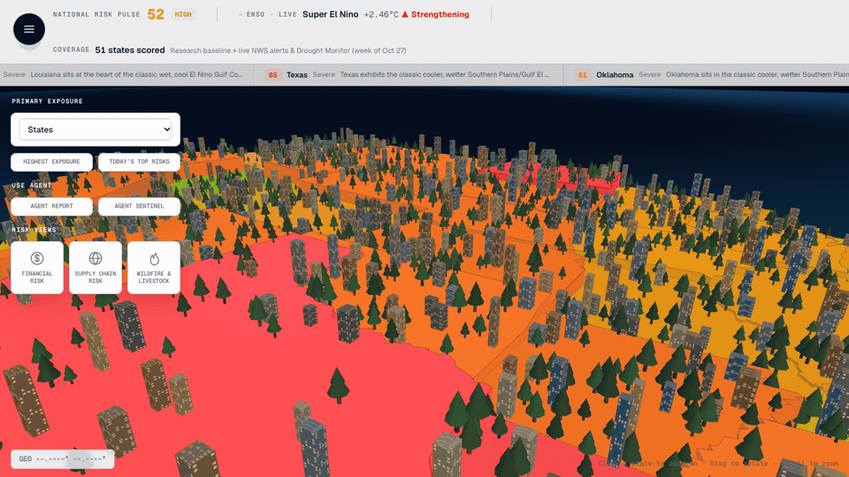
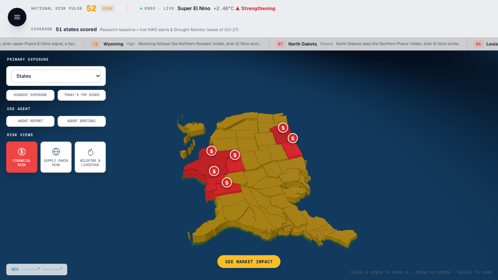
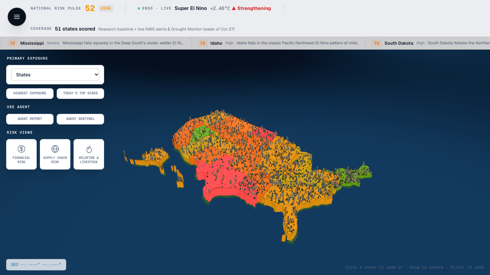
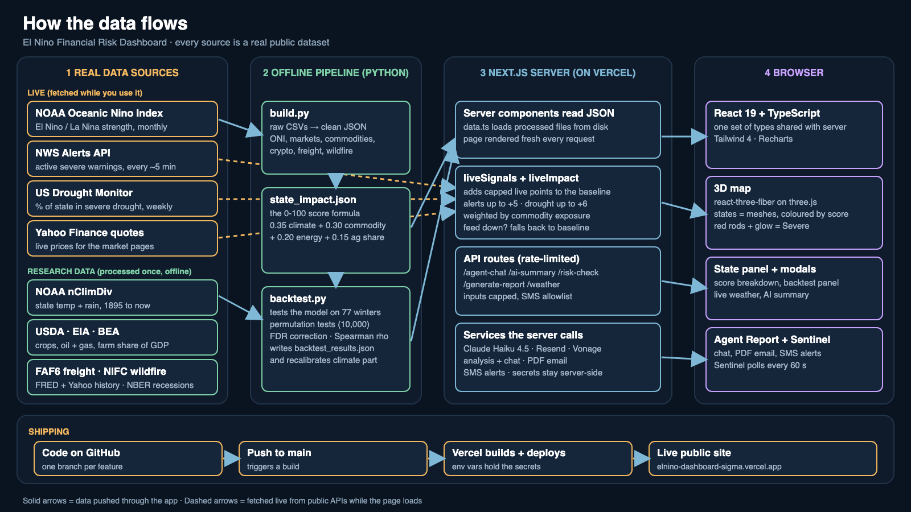

# El Niño Financial Risk Dashboard

A 3D, interactive map that scores every US state's financial exposure to El Niño, shows exactly how each score is built, **tests itself against 77 winters of real climate data**, and acts on it: two Claude-powered agents answer questions, email PDF briefings, and text you when a state turns Severe.

**Live demo: https://elnino-dashboard-sigma.vercel.app**



> A research project, not an official index and not investment advice.

## Why

El Niño reliably shifts US weather (cooler and wetter across the South, milder and drier in the North), which hits crops, cattle, oil and gas, and eventually lenders and insurers. There is plenty of research on El Niño and markets as a whole, but a farm lender or a regional insurer holds exposure to specific places. I couldn't find a state-by-state financial risk score, so I built one and made every step traceable.

## What it does

| Feature | What you see |
|---|---|
| **3D risk map** | All 50 states plus DC as 3D meshes, scored 0 to 100 (Low / Moderate / High / Severe at 75+). Built with react-three-fiber. |
| **Score breakdown** | Click a state to see the four weighted inputs and their points, e.g. Oklahoma: climate 23.7 + commodity 30.0 + energy 20.0 + agriculture 3.1 = 77 baseline. |
| **Live layer** | Active National Weather Service warnings (up to +5) and the weekly US Drought Monitor (up to +6, scaled by crop exposure) are added on top of the baseline. If a feed is down, the state falls back to its baseline. |
| **Financial Risk view** | Map turns yellow; Severe states turn deep red, pulse, and get a rod with a dollar sign (taller = riskier). |
| **Backtest panel** | "Does history back the model?" with the results below, including the weak spots. |
| **Supply chain** | Real freight flows (FAF6) between states, coloured by origin risk. |
| **Wildfire and livestock** | Real NIFC fire perimeters (2005 to 2024) joined to livestock and poultry exposure. |
| **Agent Report** | Claude chat grounded only in the dataset. The Email Report button sends a PDF briefing with AI analysis and live weather. |
| **Agent Sentinel** | Polls every 60 s while open; when a state newly crosses into Severe, it sends an SMS saying what pushed it over. Every action is logged. |
| **Deep-dive pages** | ENSO Monitor, Financial Markets, Commodities, Cryptocurrency, Insurance and Banking. |

<p>
  
  
</p>

## How the score works

```
score = 0.35 × climate signal + 0.30 × commodity exposure + 0.20 × energy exposure + 0.15 × agriculture share of GDP
```

- **Climate signal strength:** a 50/50 blend of a hand-assigned strength and the strength *measured* from history (see backtest).
- **Commodity and energy exposure:** high / medium / low tiers from USDA and EIA production rankings.
- **Agriculture share:** BEA state GDP data; states without a sourced figure get a flat conservative default, never an invented number.
- The weights and tiers are modelling choices, not fitted estimates. See [`data/state_impact_README.md`](data/state_impact_README.md).

## Backtest

`python3 data/backtest.py` tests the model against **77 winters (27 El Niño) of NOAA nClimDiv state climate data**, using permutation tests (10,000 shuffles) and Benjamini-Hochberg FDR correction across the family of tests.

| Test | Result |
|---|---|
| Temperature labels match history | **23 of 23** directional labels |
| Precipitation labels match history | **25 of 32** (weak spots: IA, KY, MO, ND, NE, SD, TN) |
| Hand-assigned strength vs. measured | Spearman ρ = **0.73** (n = 50) |
| Market transmission (7 series chosen in advance) | **None significant** (smallest q = 0.64); with 5 to 12 independent El Niño episodes the test has little power, so this reads "not detected", not "no effect" |

The mistakes it found were fixed: `python3 data/backtest.py --apply` recalibrates the climate component (idempotent). Arkansas went 76 → 66, and states at Severe went from 8 to 5. Full method and limits: [`data/backtest_README.md`](data/backtest_README.md).

## Data flow



**Live (fetched while you use it):** NOAA Oceanic Niño Index, NWS alerts API, US Drought Monitor, Yahoo Finance quotes.
**Research data (processed offline by Python):** NOAA nClimDiv, USDA, EIA, BEA, FAF6 freight, NIFC wildfire, FRED and Yahoo history, NBER recessions.

## Tech stack

- **App:** Next.js 16 (App Router), React 19, TypeScript, Tailwind CSS 4, Recharts
- **3D:** react-three-fiber, drei, three.js
- **Data pipeline:** Python (pandas, NumPy, SciPy) → JSON read by server components
- **AI:** Claude Haiku 4.5 via the Anthropic API
- **Email / SMS:** Resend (with `@react-pdf/renderer` for the PDF) / Vonage
- **Hosting:** Vercel, deployed from GitHub (one branch per feature)

## Run it locally

```bash
npm install
cp .env.example .env.local   # then fill in the values you need
npm run dev                  # http://localhost:3000
```

The map, scores, backtest panel and live layer need **no keys**. Keys only enable the agents:

| Variable | Enables |
|---|---|
| `ANTHROPIC_API_KEY` | Agent Report chat, AI summaries, PDF analysis |
| `RESEND_API_KEY`, `RESEND_FROM_EMAIL` | Emailed PDF reports (Resend's sandbox sender only delivers to your own account email until you verify a domain) |
| `VONAGE_API_KEY`, `VONAGE_API_SECRET`, `VONAGE_FROM_NUMBER` | SMS alerts |
| `SMS_ALLOWLIST` | Comma-separated `+E.164` numbers allowed to receive texts (**deny by default**) |

Rebuild the processed data or rerun the backtest:

```bash
pip install pandas numpy scipy
python3 data/build.py
python3 data/backtest.py          # test only
python3 data/backtest.py --apply  # also recalibrate state_impact.json
```

## Built for a public site

Every API route is rate-limited per client, chat and report inputs are capped, SMS only goes to an approved number list, and every external feed has a fallback. The rate limiter is in-memory per server instance, so it is a first line of defence, not a global quota.

## Known limitations

- The baseline is a research composite; the weights are judgement, and the exposure tiers are qualitative.
- The backtest tests the climate and market premises, not state-level financial *outcomes* (no per-state loss data is included).
- Drought data is weekly, not real-time. Weather alerts refresh about every 5 minutes.
- Agent Sentinel only checks while a browser tab is open, and its "already alerted" memory lives in each server instance.
- No automated tests yet.

## Roadmap

- A "how exposure is typically hedged" educational view (not advice)
- Server-scheduled alerts that run with nobody watching, with a shared store for alert state
- Testing the score against real historical losses (for example crop insurance payouts)
- Lagged-effect and strong-events-only backtests
- Automated tests and CI

## Data sources

NOAA (Oceanic Niño Index, nClimDiv), National Weather Service, US Drought Monitor, USDA NASS/ERS, EIA, BEA, FAF6 (ORNL / BTS), National Interagency Fire Center, FRED, NBER, Yahoo Finance. See the READMEs in [`data/`](data/) for how each was used.
